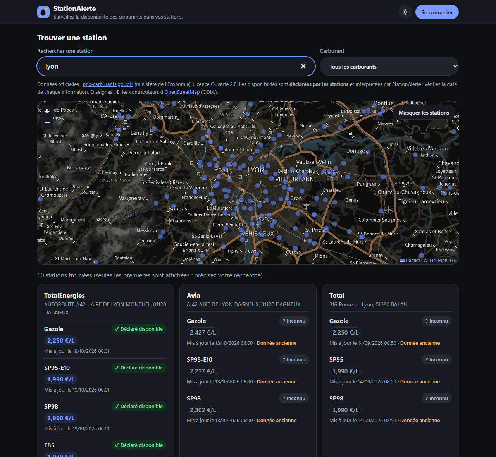
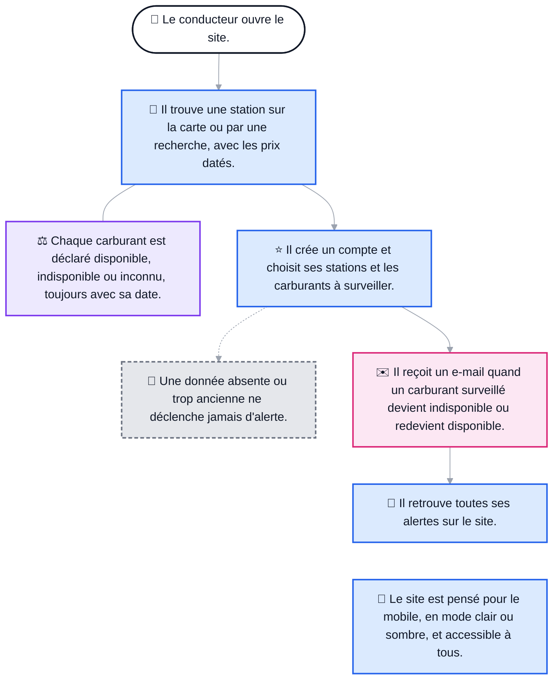
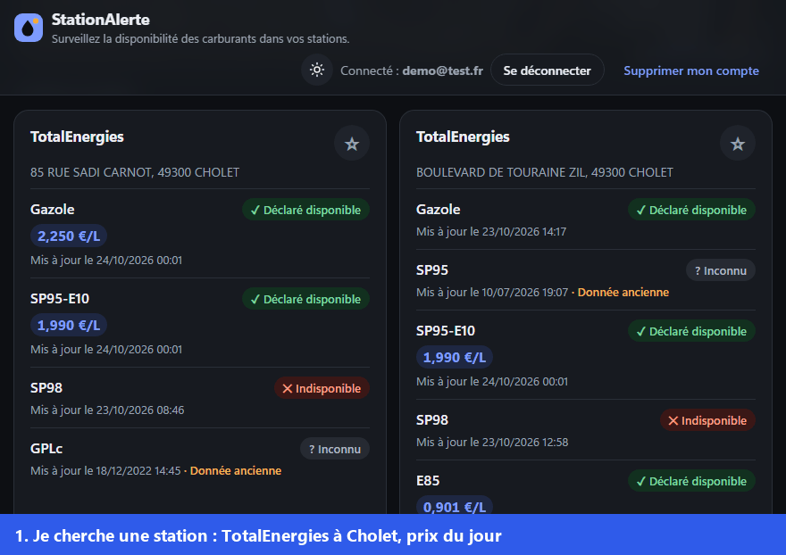
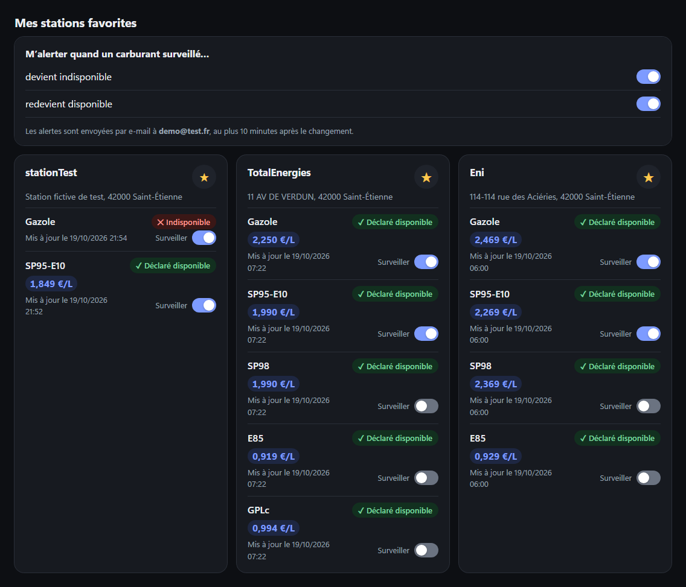
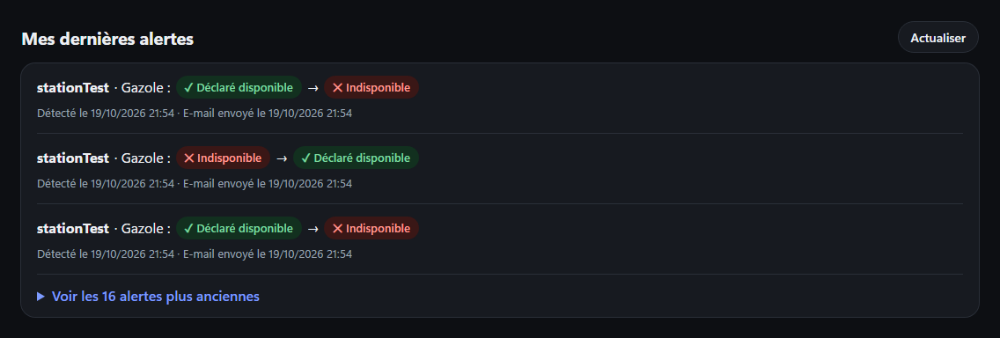
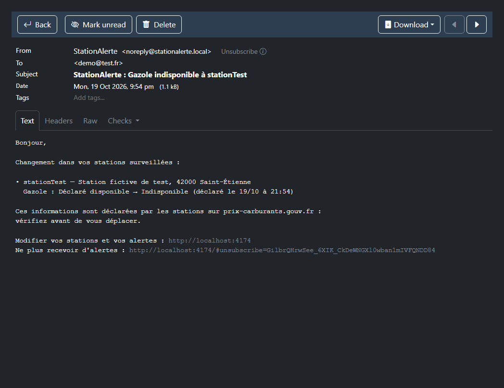
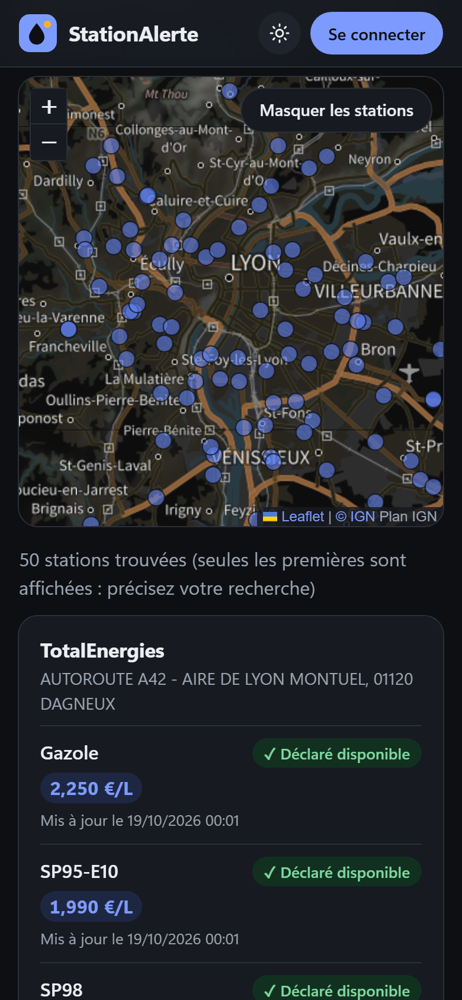
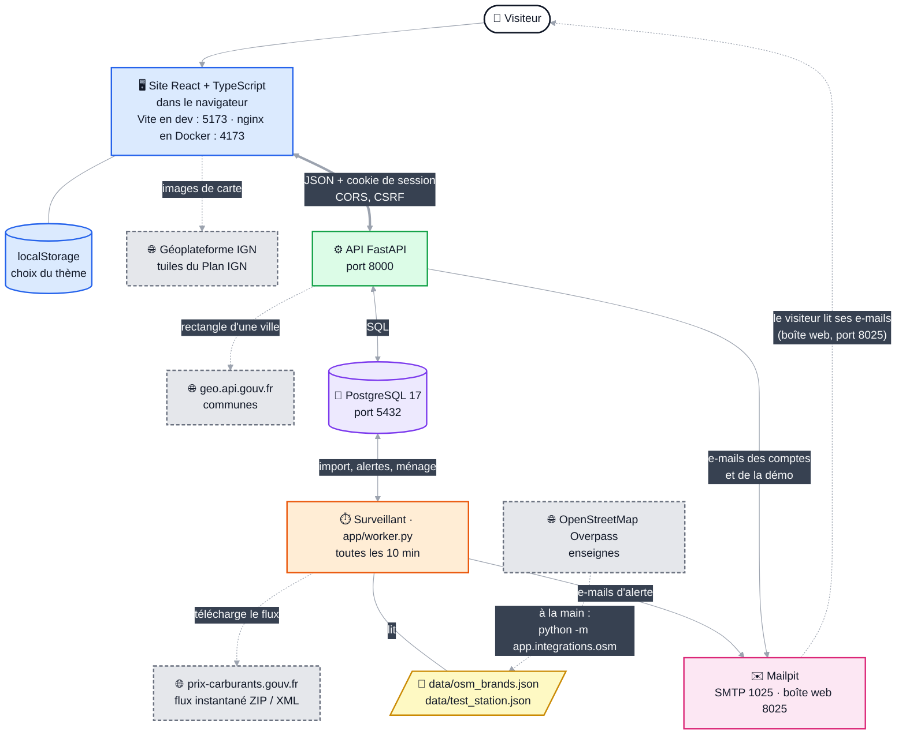

# StationAlerte

**Être prévenu par e-mail quand le carburant manque — ou revient — dans ses stations-service.**

StationAlerte affiche la disponibilité des carburants dans les 9 800 stations françaises, à partir des données officielles, et envoie une alerte quand un carburant que vous surveillez devient indisponible ou redevient disponible.




## Le problème

Lors des pénuries de carburant (comme à l'automne 2022), les automobilistes font le tour des stations au hasard. Les stations déclarent pourtant leurs ruptures sur le site officiel [prix-carburants.gouv.fr](https://www.prix-carburants.gouv.fr/), mais personne ne vous prévient quand **vos** stations sont concernées. D'ailleurs, j'ai décidé de me lancer dans ce petit projet, après avoir fait 3 pompes différentes pour trouver du carburant.

## Ce que fait l'application



- **Chercher** : toutes les stations sur une carte (un clic sur un point la recherche) ; recherche par enseigne, ville, code postal ou adresse (« leclerc lyon »), insensible aux accents et aux abréviations ; filtre par carburant. Le prix au litre de chaque carburant est affiché avec sa date.
- **Suivre** : un compte, des stations favorites, et pour chacune les carburants à surveiller.
- **Être alerté** : le surveillant vérifie les données toutes les 10 minutes et envoie un e-mail quand un carburant surveillé devient indisponible ou redevient disponible (au choix). L'historique des alertes est sur le site, et chaque e-mail contient un lien de désabonnement.
- **Tout essayer depuis le site** : en bas de page, un **espace de démonstration** change l'état des carburants de *stationTest*, une station fictive signalée comme telle, pour déclencher une vraie alerte et son e-mail en quelques secondes, sans terminal (local uniquement).
- **Une information honnête** : trois états seulement — *Déclaré disponible*, *Indisponible*, *Inconnu*. Une donnée absente ou trop ancienne est toujours affichée « Inconnu », jamais « Indisponible », et ne déclenche jamais d'alerte. Chaque information affiche sa date.
- **Une interface pensée pour le mobile** : design sobre, mode clair ou sombre au choix (ou celui de l'appareil), carte en version « nuit » en mode sombre, accessible au clavier et aux lecteurs d'écran.

**En action** : une vraie station est ajoutée aux favoris, son gazole est surveillé, puis le flux officiel y déclare une rupture ; la fiche, l'historique des alertes et l'e-mail suivent.



**Favoris et carburants surveillés**



**Historique des alertes**



**E-mail d'alerte**



**Sur mobile**




*Captures et animation faites en local avec le compte de démonstration (`demo@test.fr`), sur une installation Docker séparée. La rupture de l'animation est réelle (déclarée le 23/10/2026 à 14 h 17 dans le flux officiel) ; pour la filmer, cette station a été remise « disponible » dans la base de cette installation, puis le flux relu : l'alerte et l'e-mail viennent de ce vrai passage. « stationTest » est une station fictive de test, signalée comme telle sur le site ; toutes les autres stations sont réelles.*


## Lancer le projet

Prérequis : lancez [Docker Desktop](https://www.docker.com/products/docker-desktop/) avant d'executer le ficher lancant la démo. 


Sous Windows, double-cliquer sur **`lancer-demo.bat`** ; sur Mac ou Linux, lancer **`sh lancer-demo.sh`**. Ils font tout cela, créent le compte de démonstration et ouvrent le site.


- Site : http://localhost:4173 (attendre quelques secondes le premier import des stations) 
- e-mails : http://localhost:8025 (Mailpit) ; 
- API : http://localhost:8000/docs 
- arrêt : `docker compose --profile app stop`.


**À propos des e-mails : Mailpit.** Le projet tourne en local, donc aucun e-mail ne part sur internet. Tous ceux que l'application envoie (alertes, confirmation d'inscription, mot de passe oublié, suppression de compte) sont capturés par [Mailpit](https://mailpit.axllent.org/), un faux serveur d'e-mails lancé par Docker. On les lit dans sa boîte de réception web, sur http://localhost:8025. On peut ainsi tester tout le parcours, liens compris, sans vraie adresse et sans risque d'écrire à quelqu'un. Un mail de test avec son mot de passe est d'ailleurs fournis en bas de la page.


Si vous voulez manipuler l'API et le code du site, sans devoir tout relancer à chaque fois pour actualiser la page;
 depuis la racine du projet :

```bash
docker compose --profile app up -d --build             # construit et démarre tout (premier lancement : quelques minutes)
docker compose exec worker python -m app.demo creer    # facultatif : compte de démonstration
```

ou bien lancez le fichier **`sh lancer-dev.sh`**


## Architecture




- Le **site** ne contient aucune donnée ni aucun secret : il interroge l'**API**, qui lit la base.
- Le **surveillant** est un programme séparé : il télécharge le flux officiel, enregistre les changements de disponibilité, crée les alertes et envoie les e-mails. L'API, elle, ne télécharge jamais rien : le site reste rapide et fonctionne même si la source officielle est en panne.
- **PostgreSQL** garde les stations, l'historique des changements, les comptes, les sessions et les alertes. Le schéma évolue par migrations (Alembic).


## Technologies

| Partie | Technologies |
|---|---|
| Site | React 19, TypeScript, Vite, Leaflet (carte), CSS |
| API et surveillant | Python 3.14, FastAPI, Pydantic, SQLAlchemy 2, Alembic, Argon2, httpx, uv |
| Base de données | PostgreSQL 17 (Docker Compose) |
| E-mails | SMTP ; Mailpit en local (Docker Compose) |
| Tests | pytest, Vitest, React Testing Library, Schemathesis |


## Sources et licences

- Code : licence [MIT](LICENSE).
- Données des stations : [prix-carburants.gouv.fr](https://www.prix-carburants.gouv.fr/), ministère de l'Économie, Licence Ouverte 2.0.
- Enseignes : © les contributeurs d'[OpenStreetMap](https://www.openstreetmap.org/copyright) (ODbL).
- Fond de carte Plan IGN et communes ([API Géo](https://geo.api.gouv.fr/)) : services publics, Licence Ouverte.
