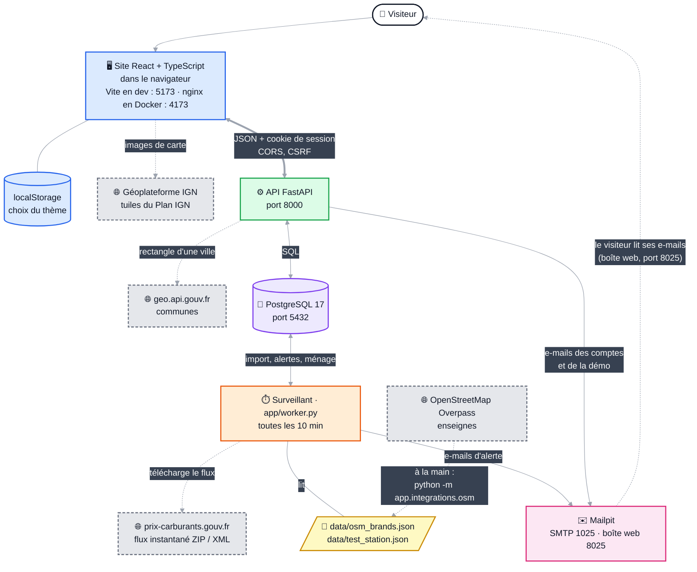
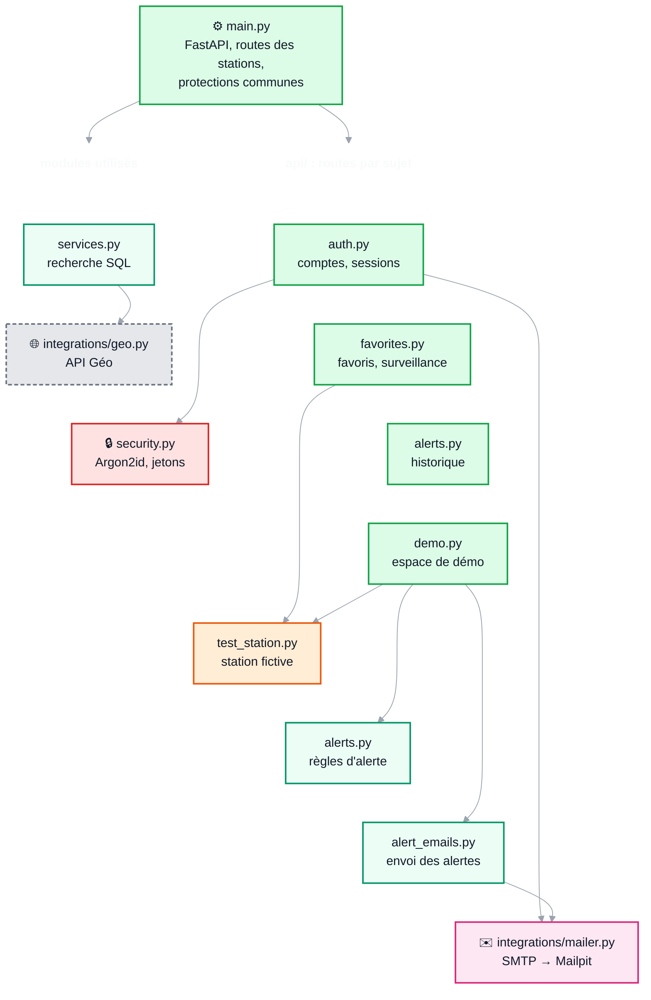
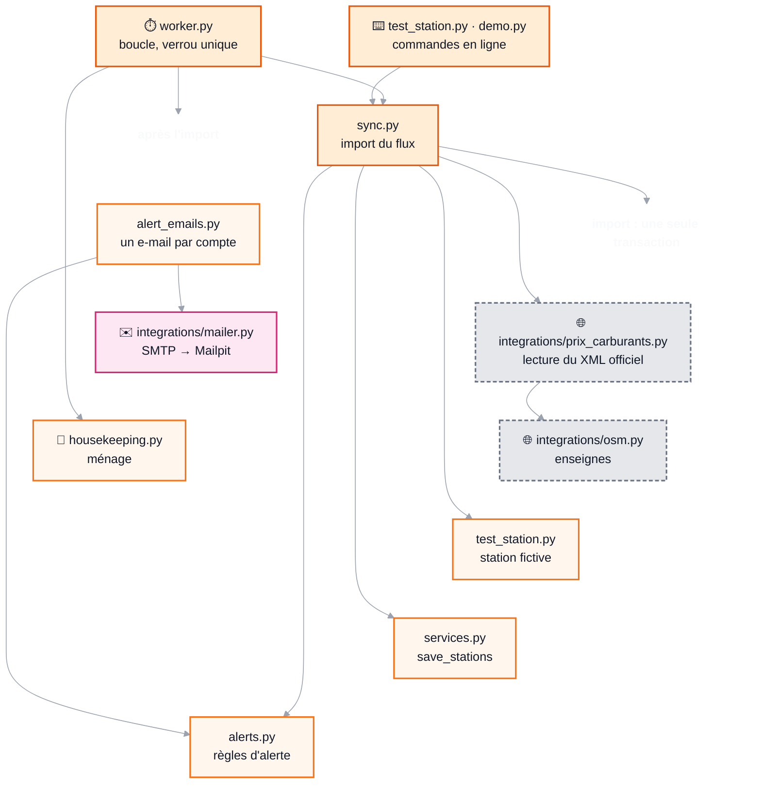

# Architecture de StationAlerte

Trois schémas : la vue d'ensemble, le backend et les routes de l'API. Ils sont écrits en **Mermaid** (du texte) : GitHub les affiche comme des diagrammes, et les mettre à jour revient à modifier quelques lignes de ce fichier. Pour les voir dans VS Code : extension « Markdown Preview Mermaid Support ».

**Code couleur**, le même dans les trois schémas :

| Couleur | Élément |
|---|---|
| 🟦 bleu | site (navigateur, React) |
| 🟩 vert | API (FastAPI) |
| 🟧 orange | surveillant et commandes en ligne |
| 🟪 violet | base de données PostgreSQL |
| 🩷 rose | e-mails (Mailpit) |
| 🟥 rouge | sécurité |
| ⬜ gris pointillé | services publics extérieurs |
| 🟨 jaune | fichiers |

---

## 1. Vue d'ensemble

Quatre programmes : le **site** (dans le navigateur), l'**API**, le **surveillant** et la **base de données**, plus **Mailpit** qui capture les e-mails. Les flèches pointillées vont vers des services publics extérieurs.

Points clés :
- **L'API ne télécharge jamais le flux officiel** : seul le surveillant le fait. Le site reste rapide même si la source est en panne.
- **Aucun secret dans le site** : il n'a que l'adresse de l'API. Le cookie de session est `HttpOnly`, illisible par JavaScript.
- **Aucun e-mail ne sort du PC** : tout arrive dans Mailpit.

---

## 2. Backend : les modules Python

`backend/app/`. Une flèche `A --> B` veut dire « A utilise B ».

**Côté API** (ce qui répond au site) :

**Côté surveillant** (ce qui tourne en fond toutes les 10 minutes) et commandes en ligne :

Partout : `models.py` (tables), `schemas.py` (forme du JSON), `database.py` (connexion) et `config.py` (réglages lus dans `.env`). Ces liens-là ne sont pas dessinés.

---

## 3. Routes de l'API

Toutes les requêtes passent d'abord par les mêmes protections. En italique sous chaque route : les tables qu'elle lit ou modifie. Documentation interactive : http://localhost:8000/docs.

```mermaid
%%{init: {"theme": "dark", "themeVariables": {"background": "transparent", "lineColor": "#9ca3af", "edgeLabelBackground": "#374151", "textColor": "#f9fafb"}}}%%
flowchart TB
    req(["🖥️ Requête du site"])

    hMw["🔒 protections communes (main.py)"]
    cors["CORS : seulement localhost:5173 et :4173"]
    csrf["CSRF : écriture refusée (403)<br/>si l'origine est un autre site"]
    headers["En-têtes : nosniff, no-referrer,<br/>frame-ancestors 'none'"]
    errors["Erreurs propres : 422 sans la valeur reçue,<br/>503 base ou source indisponible, 400"]

    hPublic["🌍 sans compte"]
    s1["GET /stations?q&fuel&limit<br/><i>stations, fuels</i>"]
    s2["GET /stations/positions<br/><i>stations (en cache)</i>"]
    s3["GET /stations/{id}<br/>GET /stations/{id}/fuels<br/><i>stations, fuels</i>"]
    s4["GET /cities/bounds?q<br/><i>🌐 geo.api.gouv.fr</i>"]
    a1["POST /auth/register<br/>POST /auth/confirm-email<br/><i>users, jetons, journal</i>"]
    a2["POST /auth/login<br/>POST /auth/logout<br/><i>users, sessions, journal</i>"]
    a3["POST /auth/password-reset/request<br/>POST /auth/password-reset/confirm<br/><i>users, jetons, sessions</i>"]
    a4["POST /auth/unsubscribe<br/><i>users, jetons</i>"]
    d1["GET /demo/test-station<br/>PUT /demo/test-station/fuels/…<br/><i>stations, alertes · 404 sans DEMO_MODE</i>"]

    hPrivate["🔑 avec session (sinon 401)"]
    m1["GET /me · DELETE /me<br/>PUT /me/notifications<br/><i>users, sessions</i>"]
    m2["GET /me/favorites<br/>PUT · DELETE /me/favorites/{id}<br/>PUT /me/favorites/{id}/fuels<br/><i>favorites, favorite_fuels</i>"]
    m3["GET /me/alerts<br/><i>alerts, availability_events</i>"]

    req --> hMw ~~~ cors ~~~ csrf ~~~ headers ~~~ errors
    errors --> hPublic ~~~ s1 ~~~ s2 ~~~ s3 ~~~ s4 ~~~ a1 ~~~ a2 ~~~ a3 ~~~ a4 ~~~ d1
    errors --> hPrivate ~~~ m1 ~~~ m2 ~~~ m3

    classDef front fill:#dbeafe,stroke:#2563eb,stroke-width:2px,color:#111827
    classDef sec fill:#fee2e2,stroke:#dc2626,stroke-width:2px,color:#111827
    classDef back fill:#dcfce7,stroke:#16a34a,stroke-width:2px,color:#111827
    classDef priv fill:#fef3c7,stroke:#d97706,stroke-width:2px,color:#111827
    classDef heading fill:transparent,stroke:transparent,color:#f9fafb,font-weight:bold
    class req front
    class cors,csrf,headers,errors sec
    class s1,s2,s3,s4,a1,a2,a3,a4,d1 back
    class m1,m2,m3 priv
    class hMw,hPublic,hPrivate heading
```

